# WebODM Importer

A QGIS plugin that imports [WebODM](https://github.com/OpenDroneMap/WebODM) task output (ZIP) into QGIS, automatically detects assets, generates derived layers, and organises them into a named layer group.

| Orthophoto | Terrain Model |
|------------|---------------|
| 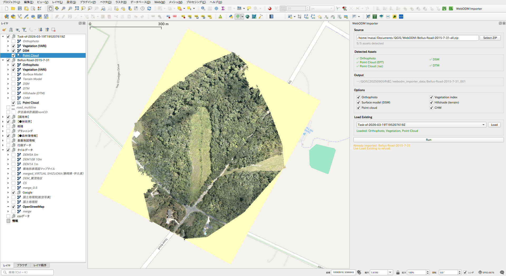 | 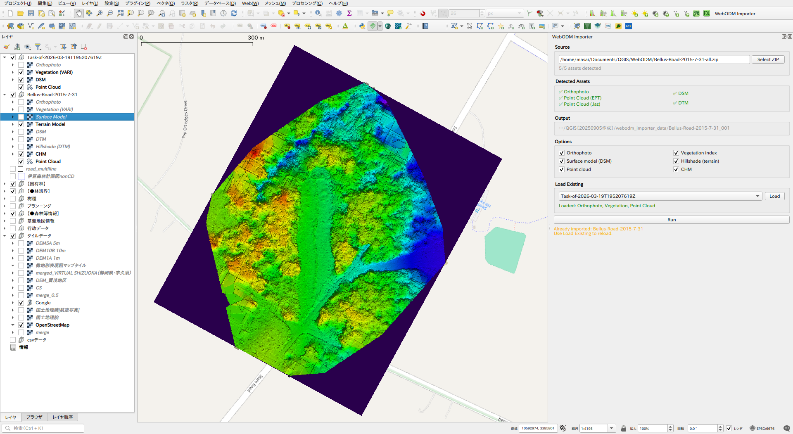 |

## Features

- **ZIP import**: Select a WebODM task ZIP — no manual extraction required
- **Asset detection**: Automatically detects orthophoto, DSM, DTM, and point cloud (EPT or .laz)
- **Derived layers**: Generates CHM (DSM − DTM), vegetation index (VARI), hillshade, composite surface/terrain models, and CS Map (CS-style terrain visualization)
- **Composite models**: Surface Model (DSM + hillshade) and Terrain Model (DTM + hillshade) baked into single RGB GeoTIFFs
- **Duplicate detection**: MD5 hash check prevents re-importing the same ZIP twice
- **Layer organisation**: All layers are grouped under the dataset name at the top of the layer tree
- **Background processing**: QGIS stays usable while layers are generated; progress shows which layer is being created and how far it has got, and **Stop** takes effect without waiting for the current layer to finish
- **Large datasets**: Orthophotos and elevation models are processed in parts, so memory use stays low
- **Failure handling**: If one layer cannot be created, the others are still added, no broken file is left behind, and the reason is shown (see [Notes](#notes))
- **Point cloud retry**: A point cloud that failed or timed out can be added later on its own, without importing everything again

## Output structure

```
{project}/webodm_importer_data/{dataset_name}/
├── odm_orthophoto/odm_orthophoto.tif   ← extracted from ZIP
├── odm_dem/dsm.tif
├── odm_dem/dtm.tif
├── odm_georeferencing/odm_georeferenced_model.laz  ← LAZ fallback
├── entwine_pointcloud/ept.json                     ← EPT (preferred)
├── entwine_pointcloud/ept-data/…
├── vegetation.tif                       ← generated
├── hillshade_dsm.tif                    ← generated
├── hillshade_dtm.tif                    ← generated
├── surface_model.tif                    ← generated
├── terrain_model.tif                    ← generated
├── cs_map.tif                           ← generated
├── chm.tif                              ← generated
├── forest_naturalness_index.tif         ← generated (prototype, FOL VS Export only)
└── .import_meta.json                    ← hash/generation record
```

### Preparing your own data

If you have your own DEM/DSM files, you can use this plugin without WebODM by placing files in the exact paths shown above.

**Minimum required files:**

```
{project}/webodm_importer_data/{dataset_name}/
├── odm_dem/dsm.tif    ← DSM (surface model)
└── odm_dem/dtm.tif    ← DTM (terrain model)
```

**Optional:**

```
├── odm_orthophoto/odm_orthophoto.tif
└── odm_georeferencing/{name}.las  or  .laz   ← filename is flexible
```

Hillshade, composite models (Surface Model / Terrain Model), CS Map, CHM, and vegetation index are all
**generated by the plugin** from the files above. Layers generated by this plugin are marked with `*`,
for example `Vegetation (VARI)*`.

Place the files in the structure above, then select the dataset folder via the **Load Existing** dropdown.

> **Note — FOL (Forestry Operations Lite) VS Export**
>
> ZIPs exported from the Forestry Operations Lite plugin (Virtual Shizuoka data) are also supported.
> In this format, LAS files are **not embedded** in the ZIP. Instead, the ZIP contains:
>
> - `las_sources.json` — relative paths from the ZIP to the LAS files on disk
> - `README_LAS_LINKS.txt` — S3 download URLs for the LAS files (for reference)
>
> The LAS files must be present at the relative paths listed in `las_sources.json`.
> Forestry Operations Lite keeps only the LAS files of its latest export, so for older exports some
> of them may be gone. If any of them is missing, the point cloud is not created (to avoid an
> incomplete one) and the reason is shown. A point cloud that was already converted is still loaded.

## Layer order (in QGIS)

| Layer | Description |
|-------|-------------|
| Orthophoto | RGB orthophoto |
| Vegetation (VARI) | Vegetation index (green = healthy) |
| Surface Model | DSM with hillshade baked in |
| Terrain Model | DTM with hillshade baked in |
| DSM | Raw surface elevation |
| DTM | Raw terrain elevation |
| Hillshade (DTM) | Greyscale hillshade from DTM |
| CS Map | CS-style terrain visualization from DTM (ridges, valleys and slope in one map) |
| CHM | Canopy Height Model (DSM − DTM) |
| Forest Naturalness Index (Prototype) | Vegetation index corrected for shade and surface structure (FOL VS Export only) |
| Point Cloud | EPT point cloud (preferred); falls back to LAS/LAZ with automatic COPC conversion |

## Example output — Virtual Shizuoka

<table>
  <tr>
    <td align="center"><b>Orthophoto</b></td>
    <td align="center"><b>Vegetation (VARI)</b></td>
    <td align="center"><b>Surface Model</b></td>
  </tr>
  <tr>
    <td>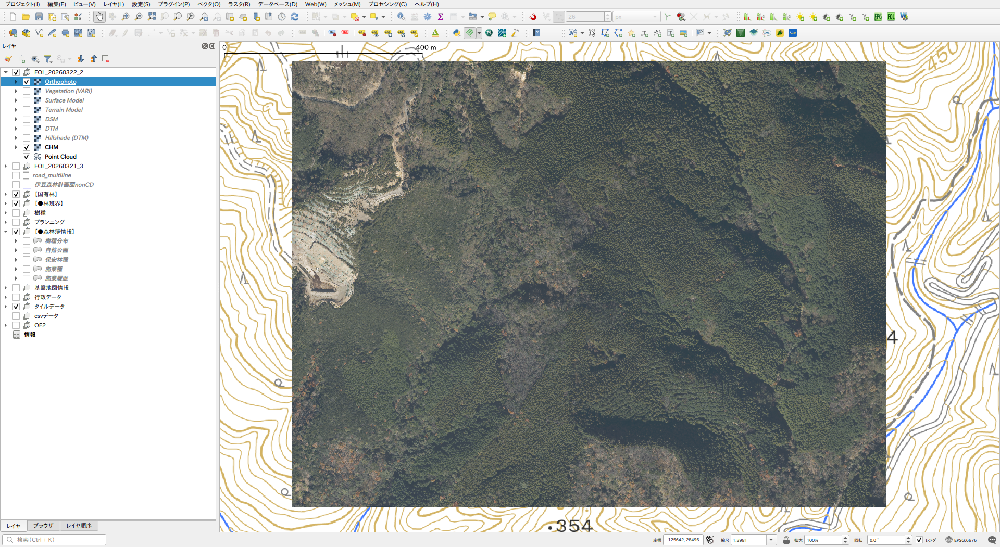</td>
    <td>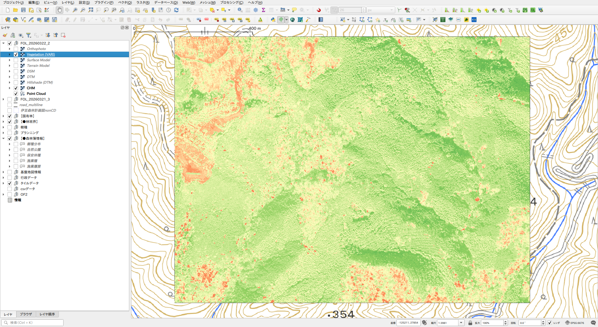</td>
    <td>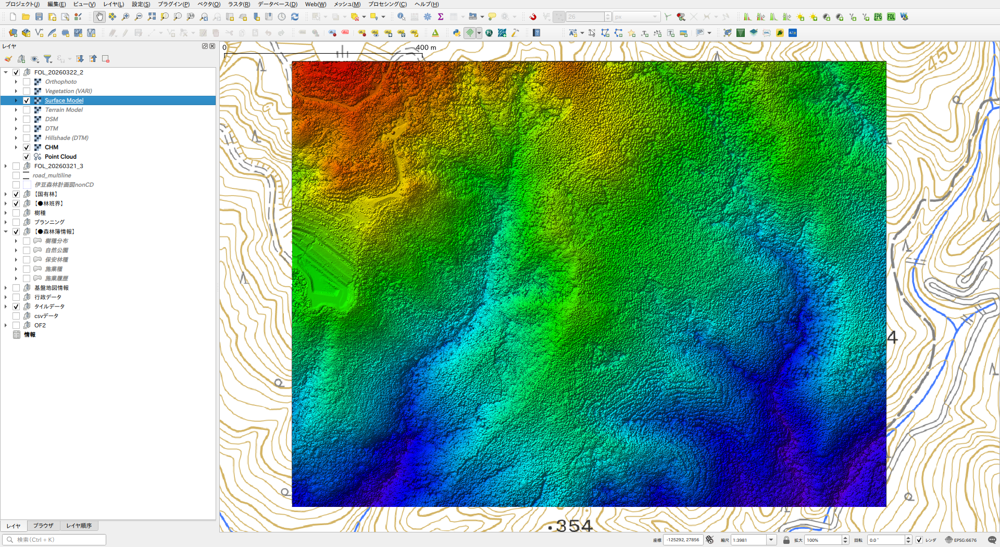</td>
  </tr>
  <tr>
    <td align="center"><b>Terrain Model</b></td>
    <td align="center"><b>DSM</b></td>
    <td align="center"><b>DTM</b></td>
  </tr>
  <tr>
    <td>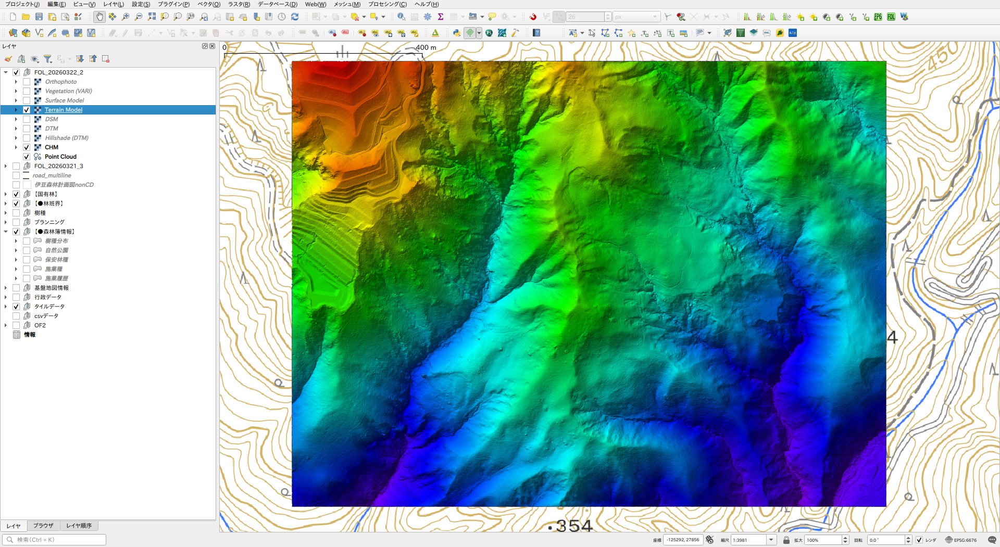</td>
    <td>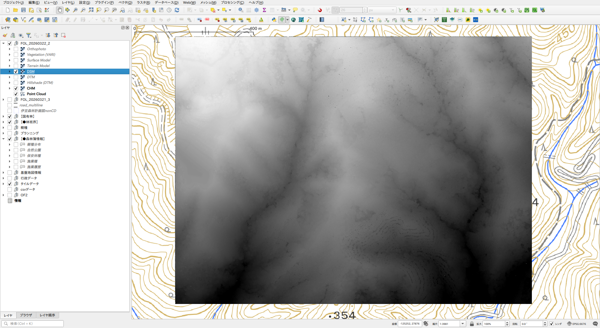</td>
    <td>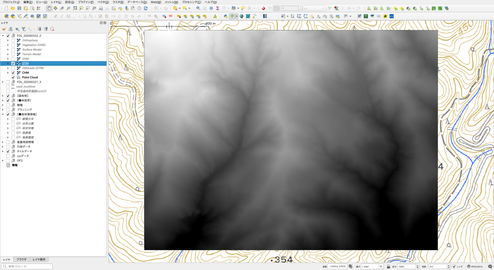</td>
  </tr>
  <tr>
    <td align="center"><b>Hillshade (DTM)</b></td>
    <td align="center"><b>CHM</b></td>
    <td align="center"><b>Point Cloud</b></td>
  </tr>
  <tr>
    <td>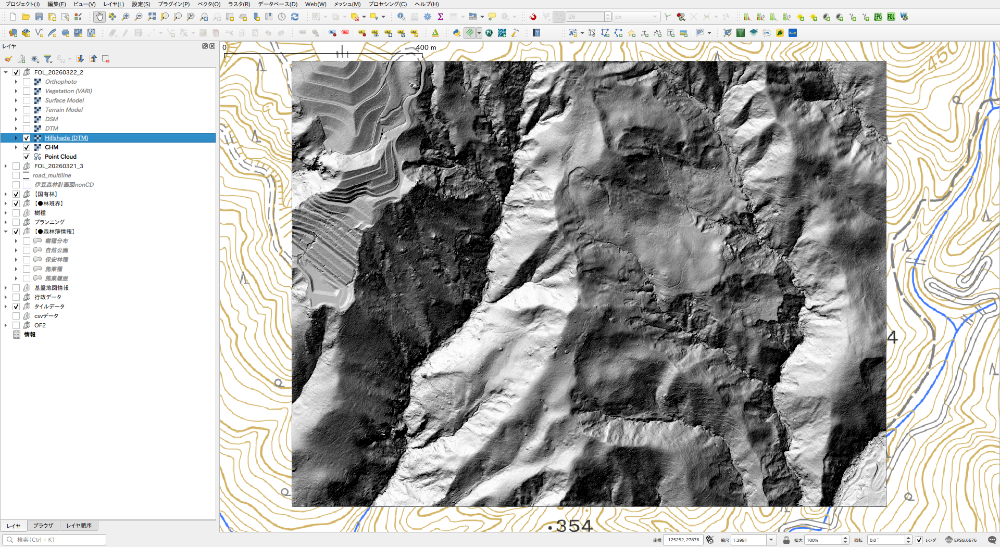</td>
    <td>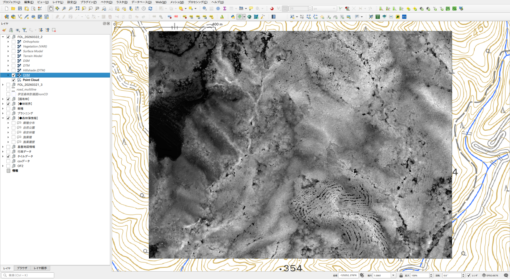</td>
    <td>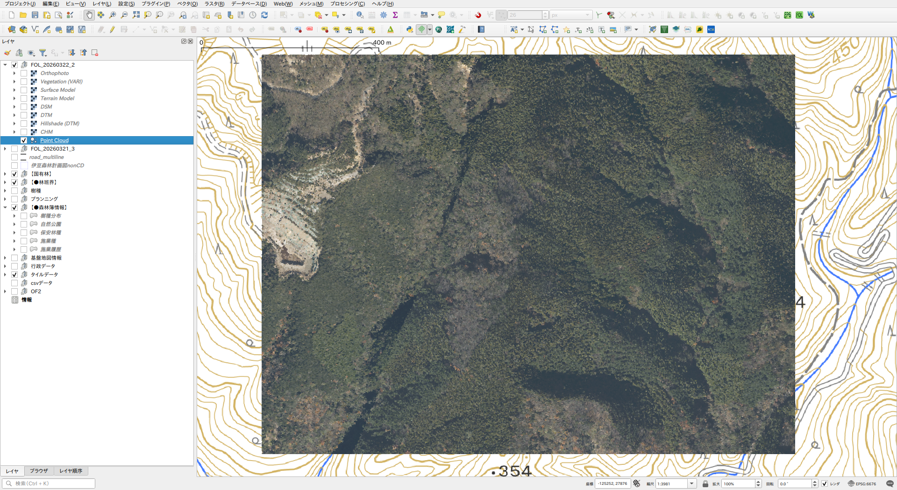</td>
  </tr>
</table>

## Usage

1. Open the window via **Raster → WebODM Importer**
2. Click **Select ZIP** to select a WebODM task output ZIP
3. Check the detected assets and select which layers to generate in **Options**
4. Click **Run**

The dataset (layer group and output folder) is named after the ZIP file. While running, the line
above the progress bar shows the current step (for example `3/9  Rendering Surface Model…`) and the
bar shows its progress. When finished, the same area shows the added layers and the layers that could
not be created; click **(details)** to read the reasons. The window keeps the same size throughout,
so longer messages are shortened there and shown in full under (details).

**Surface model (DSM + hillshade)** and **Hillshade (terrain)** are independent:
Surface model needs only a DSM and makes its own hillshade from it, while Hillshade (terrain)
creates the DTM hillshade and the Terrain Model. Datasets without a DTM can still create a
Surface Model.

### Load Existing

To reload a previously imported dataset, select it in the **Load Existing** dropdown and click
**Load**. Datasets already in the layer tree cannot be selected, except when their point cloud is
missing and can be added: then the button changes to **Add Point Cloud**, which adds only the point cloud to the
existing group (for example after a conversion timed out).

**Load** also loads the point cloud. A point cloud that was converted before is loaded directly.
LAS/LAZ files that still need converting ask for the timeout first, as in Run; choose
**Skip LAS Conversion** to load the other layers only and add the point cloud later.

## Notes

- If the same ZIP (by content hash) has already been imported, re-import is blocked
- Output folder name is auto-incremented (`_001`, `_002` …) if the name already exists
- EPT and COPC point clouds load via built-in QGIS providers (no additional setup required)
- LAS/LAZ files are converted to COPC if the `pdal` CLI is installed
- When a layer cannot be created, the reason is shown in plain words where possible: not enough
  memory, not enough free disk space in the output folder, or no write permission. Other errors are
  shown as reported, with details in the QGIS message log (`webodm_importer`)
- The plugin window is a separate window: it can be moved behind QGIS and switched with Alt+Tab,
  and clicking the toolbar button brings it back to the front. Its size is fixed

## Colour rendering

Vegetation index layers (Vegetation (VARI) and Forest Naturalness Index) use a WebODM-like `RdYlGn`
colour ramp over a fixed range of −1 to 1, matching WebODM's own definition of VARI, so the same
colour means the same value in every import. Elevation styles can be customised after import via the
QGIS layer properties.

## CS Map

A CS-style terrain visualization generated from the DTM. Ridges are shown in red-brown, valleys in
blue, and steeper slopes darker, so the shape of the ground can be read from a single map.

CS topographic visualization was proposed by the Nagano Prefecture Forestry Research Center. This
feature is an independent implementation inspired by that concept.

WebODM DTMs are derived from photogrammetry and have low ground-surface accuracy, especially under
forest canopy. Captures over open terrain or in the leaf-off season give more reliable results.

## Forest Naturalness Index (Prototype)

An experimental option, shown only for ZIPs exported from Forestry Operations Lite's Virtual
Shizuoka Export. It starts from the vegetation index (VARI) and adds two corrections:

- **Shade**: open shade is lit mainly by bluish skylight, which makes shaded greenery read as
  healthier than it is. Areas likely to be in shade are corrected for this colour cast.
- **Surface structure**: real vegetation canopy is rarely perfectly flat. Flat, smooth areas in the
  CHM — roads, solar panels and other flat artificial ground that the vegetation index cannot tell
  apart from real plants by colour alone — are lowered, while rough canopy is raised slightly. The
  raise is kept small where the canopy is already dense, so detail there is not lost.

This is a prototype calibrated against a single test site, so results outside that context are not
guaranteed to be reliable; that is also why the option is hidden for any other import source. Smooth
but tilted surfaces, such as pitched roofs, can still be read as rough canopy.

## Requirements

- QGIS 4.0 or later
- WebODM task output ZIP

### Point Cloud

WebODM outputs EPT format (`entwine_pointcloud/ept.json`) by default when point cloud processing is enabled.
EPT is supported by all QGIS environments and requires no additional setup.

If the ZIP contains only LAS/LAZ files (no EPT), they are converted to COPC format with the `pdal`
CLI and then loaded. Several LAS files are merged into one point cloud. The converted file is kept in
the dataset's `pc_cache/` folder and reused next time.

Before converting, a dialog asks for a timeout (1–180 minutes, default 10). The timeout covers the
whole conversion, including the merge of several files. Conversion progress cannot be shown as a
percentage, so the elapsed time is shown instead.

If the conversion fails, times out or is stopped, the other layers are kept. Use
**Load Existing → Add Point Cloud** to try again, for example with a longer timeout.

Without the `pdal` CLI, LAS/LAZ point clouds cannot be converted and the Point cloud option is
unavailable. Installing it is recommended on Linux, where the QGIS PDAL provider may not be included
in standard packages.

## Support

If this plugin is helpful for your work, you can support the development here:
https://paypal.me/rawslnc

## License

This plugin is distributed under the GNU General Public License v2 or later.
See [LICENSE](LICENSE) for details.

## Author

Copyright (C) 2026 Hideharu Masai
